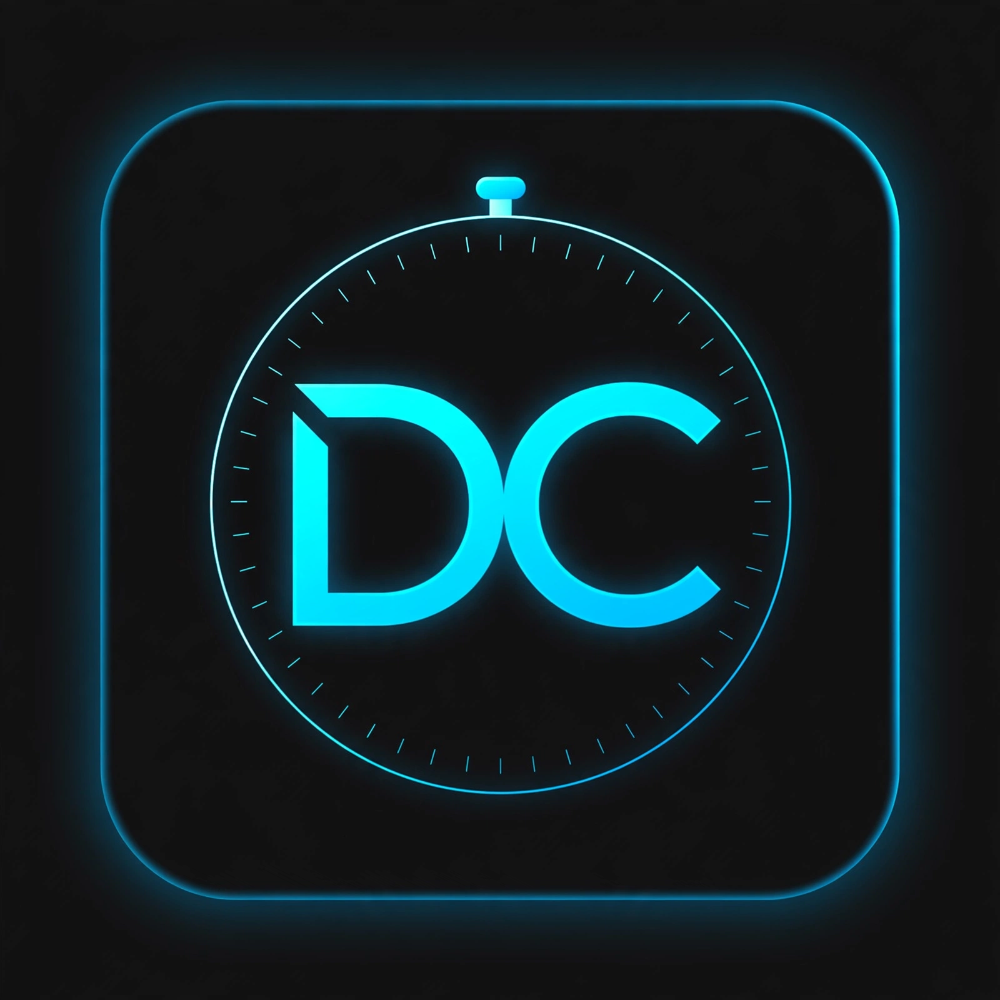

# DevCron ⏱️

Cronômetro minimalista com visual neon cyberpunk, criado para estudos de produtividade e treino de desenvolvimento Front-end.

**🔗 Acesse aqui:** https://rodrigo-sam.github.io/dev-cron/

### ✨ Features
- Cronômetro com precisão de milissegundos
- Design minimalista neon (Dark mode)
- Funciona offline - PWA instalável no celular
- Botões Iniciar, Pausar e Resetar
- Totalmente responsivo

### 🚀 Tecnologias
- HTML5
- CSS3 (Flexbox + Animações Neon)
- JavaScript puro (Vanilla JS)
- PWA - Manifest + Service Worker

### 📱 Como instalar no celular
1. Acesse https://rodrigo-sam.github.io/dev-cron/
2. No Chrome, clique nos 3 pontinhos > **Instalar app**
3. Pronto! Ícone DC na sua tela inicial.

### 👨‍💻 Autor
Feito por **Rodrigo Sam** - Primeiro projeto PWA publicado.

---
⭐ Se curtiu, deixa uma estrela no repositório!
